# Perfect Slides

Build presentations people actually remember. Ask your coding agent for a deck,
answer a handful of questions once, and get an animated HTML presentation, an
editable PowerPoint file, or both.

Works with any coding agent that can read files and run scripts. Claude Code,
Codex, Cursor, Antigravity, Windsurf and anything else that reads `AGENTS.md`.

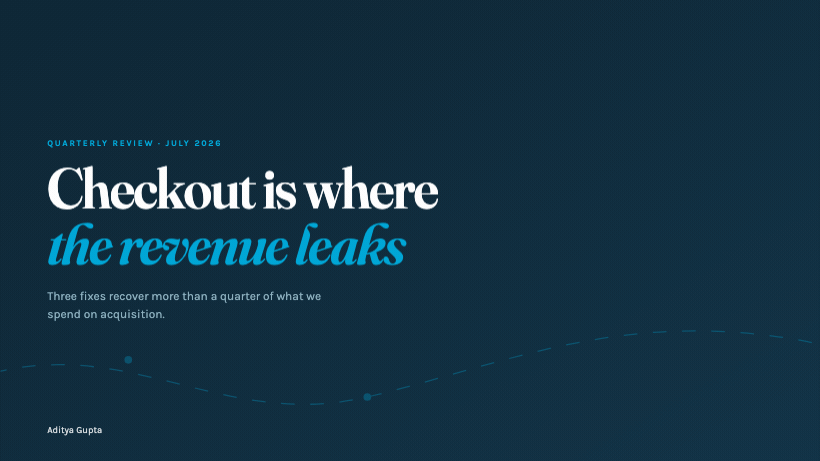

---

## What it does

- **Asks first, builds second.** All the questions in one batch, then one review,
  then it builds. No twenty-message interrogation.
- **Researches when you have nothing.** Gathers the material, tracks every source,
  shows you the findings before turning them into slides.
- **Converts what you have.** PDF, Word, Excel, Markdown or an old PowerPoint.
- **Two real formats.** HTML with genuine motion and interactivity, or a .pptx of
  native editable shapes with live chart data. Not screenshots in a PowerPoint
  wrapper.
- **Nine kinds of deck.** Pitch, consulting roadshow, consulting working deck,
  marketing plan, campaign, research, conference talk, internal update, teaching.
  Each has its own structure and its own measured density, not one template with
  the words swapped. Plus ready slide orders for twenty more specific situations.
- **Styled after a company, if you want.** Twenty design systems built in, from
  Linear to IBM to Claude, translated properly from web to slide.
- **Edit it yourself.** Press `E` in any HTML deck and click any text to change
  it. No round trip back to the agent for a typo.
- **Any language**, including right-to-left and CJK.
- **Checks its own work** before you see it.

---

## See it first

Everything below was rendered straight from the files in `examples/` by
`scripts/shoot_deck.py`. No mock-ups, no screenshots of something else.

| | |
|---|---|
| 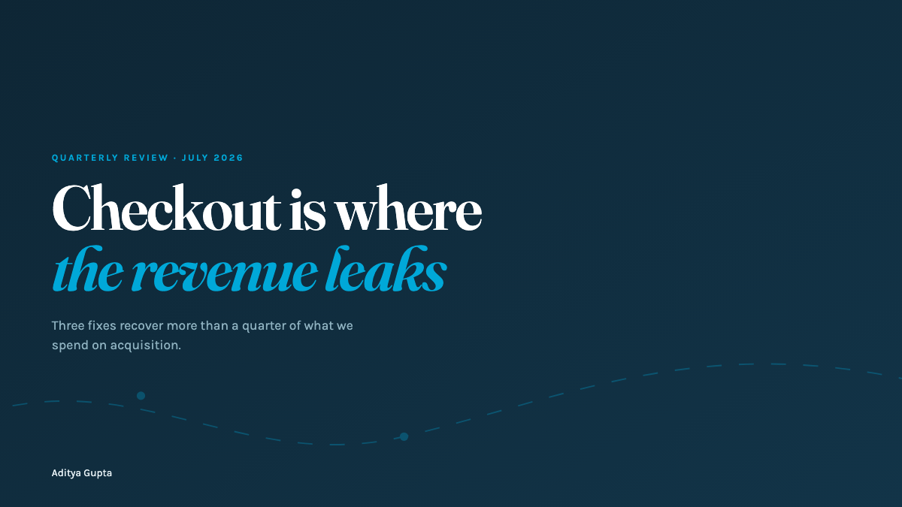 | 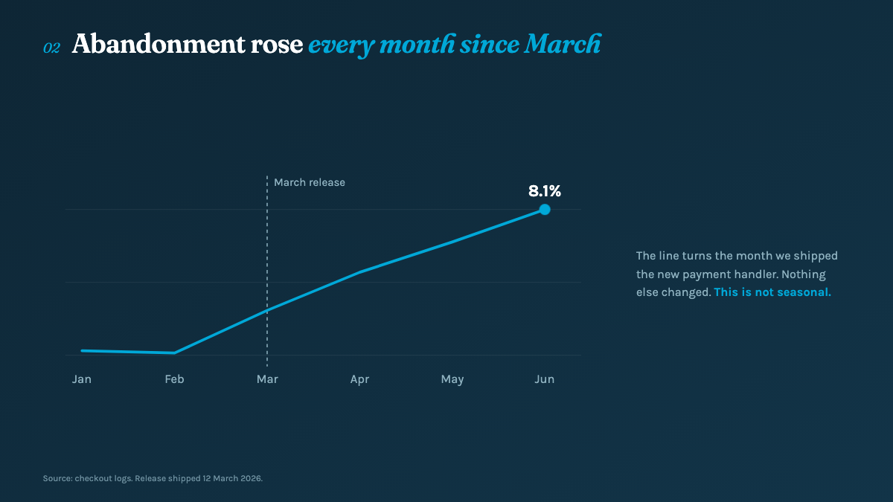 |
| 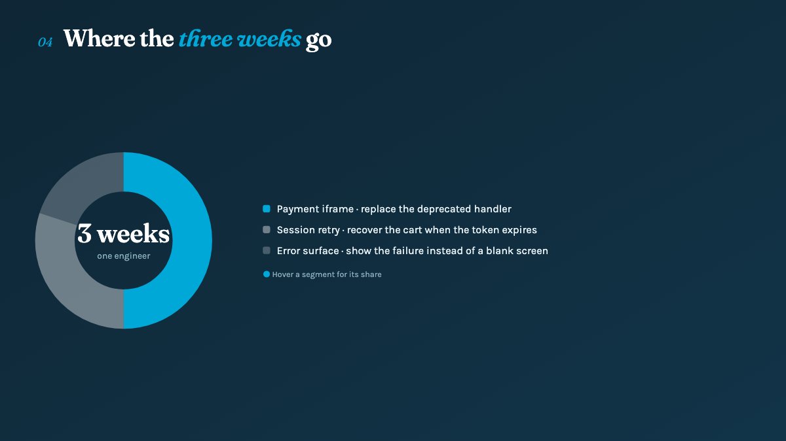 | 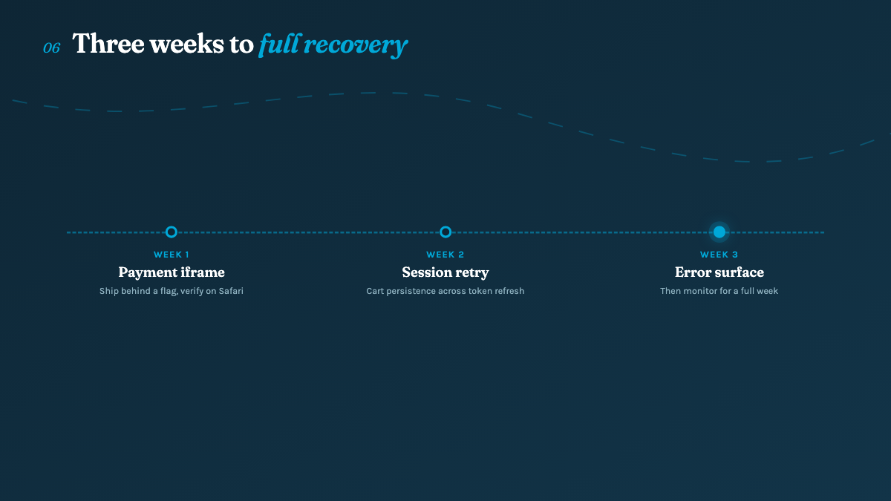 |

`examples/` holds that nine-slide consulting deck in both formats. Open
`checkout-recovery.html` in a browser, then open `checkout-recovery.pptx` in
PowerPoint and click a chart to edit its data.

---

## Eight built-in styles

Every preset in `references/design/presets.md`, rendered as the title slide of a
different deck. Same stage, same components, eight different arguments about what
a slide should be. Open `examples/style-previews.html` and use the arrow keys to
flick between them.

When you ask for a deck, the agent shortlists two or three of these and renders
you real title slides to choose from. You pick by looking, not by describing an
aesthetic in words.

| | |
|---|---|
| 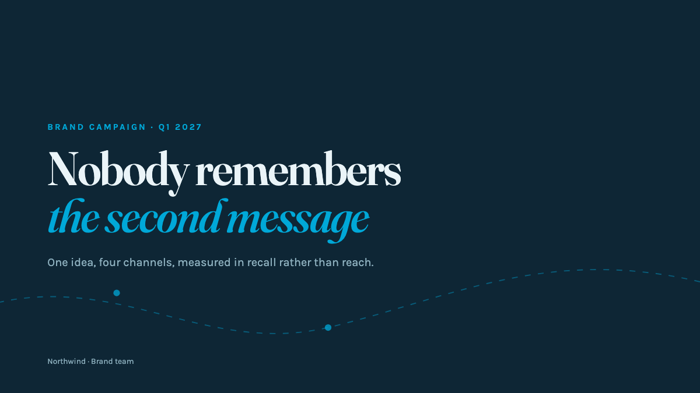<br>**Night Ride** · dark<br>Deep navy canvas, one electric accent, editorial serif against geometric sans. | 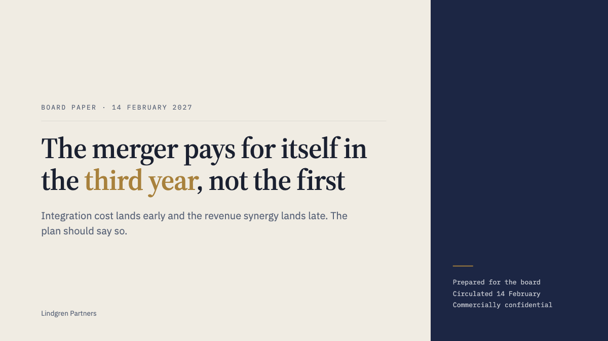<br>**Signal Brief** · light<br>Warm paper and deep navy, a single antique gold accent, serif throughout. |
| 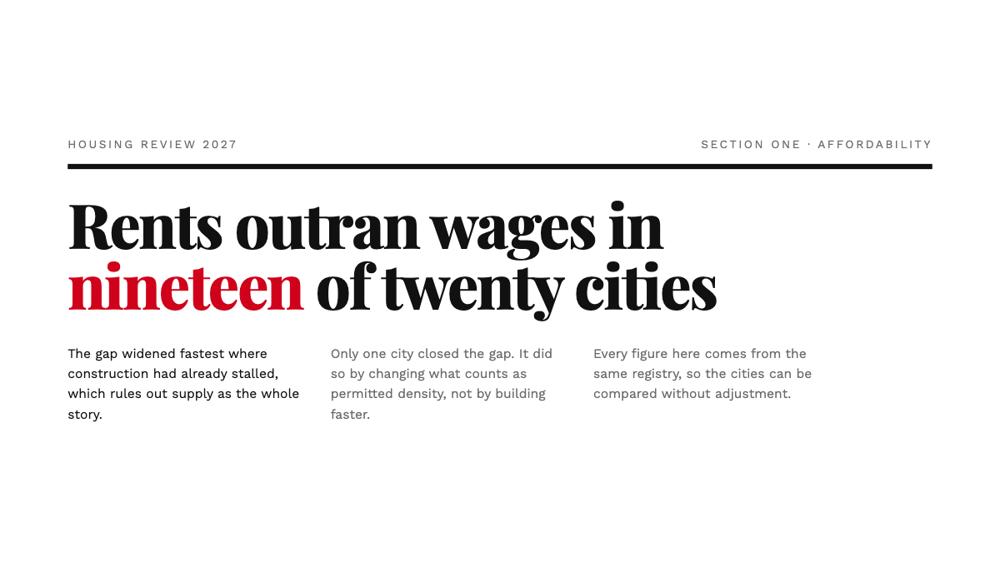<br>**Broadsheet** · light<br>White page, black type, one red mark. Newspaper structure at slide scale. | 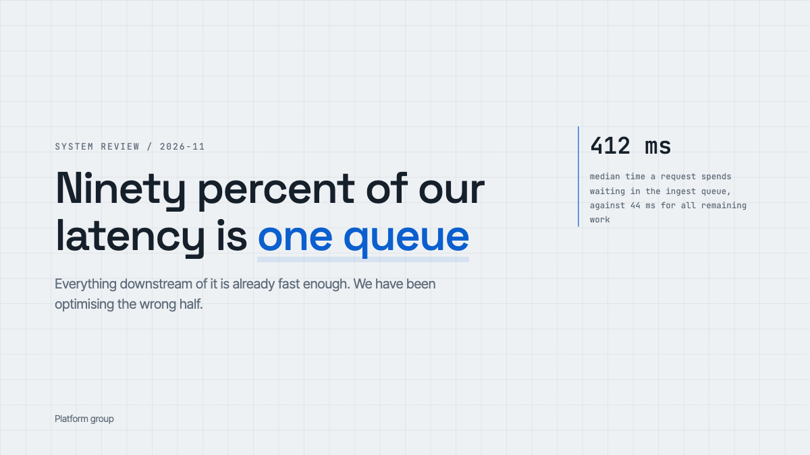<br>**Blueprint** · light<br>Cool grey ground, a fine technical grid, monospace labels on humanist body. |
| 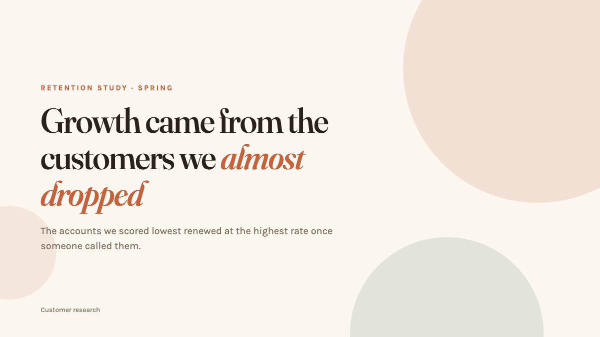<br>**Sunrise** · light<br>Warm cream, terracotta and clay, humanist type with generous space. | 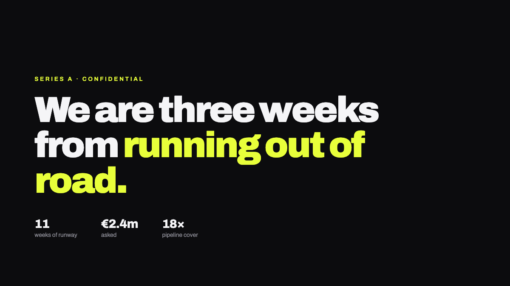<br>**Graphite** · dark<br>Near-black surface, one hot accent, tight grotesque, ruthless hierarchy. |
| 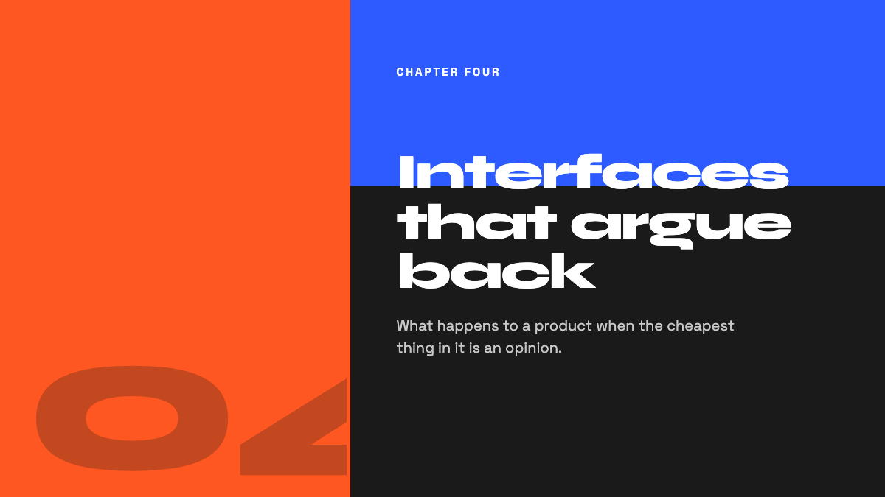<br>**Studio** · mixed<br>Full-bleed colour blocks, oversized type, hard edges, no shadows anywhere. | 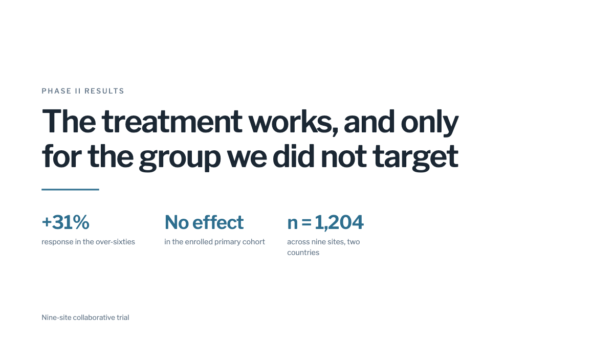<br>**Clinic** · light<br>White ground, restrained blue-grey, precise spacing, nothing decorative. |

Twenty more are company styles, in `references/design/brand-index.json`, for when
a deck has to look like it came from a particular firm.

---

## Install

**Claude Code** — two commands, nothing to clone:

```bash
/plugin marketplace add ad1tyagupta/Perfect_Slides
```

```bash
/plugin install perfect-slides@perfect-slides
```

Then run `/perfect-slides`, or just ask for a deck in plain words.

**Any other agent** — Codex, Cursor, Antigravity, Windsurf, or anything that
reads `AGENTS.md`. Clone it next to your project, or into it:

```bash
git clone https://github.com/ad1tyagupta/Perfect_Slides.git
```

Then tell your agent:

> Read Perfect_Slides/AGENTS.md and build me a presentation.

Nothing is needed to build an HTML deck by hand. The scripts need Python:

```bash
pip install -r requirements.txt && playwright install chromium
```

Or install only what a given job needs. Each script names its own dependency and
exits with the install command if it is missing.

| Script | Needs |
|---|---|
| `build_pptx.py` | `python-pptx` |
| `ingest.py` | `python-pptx`, `pypdf`, `python-docx`, `openpyxl` |
| `verify_deck.py` | `playwright`, plus `playwright install chromium` |
| `shoot_deck.py` | `playwright`, and `ffmpeg` for `--gif` only |
| `process_images.py` | `Pillow` |
| `embed_fonts.py` | nothing |
| `deploy.sh` | Node, for Vercel's CLI |

---

## Using it

Just ask:

> Build me a pitch deck about our logistics API for seed investors.

You will be asked, in one message: output format, topic, deck type, audience,
where the content comes from, and anything else worth knowing. Then it goes away
and works.

It comes back once with what it found, what it assumed, the slide outline, and
three title-slide designs to choose between. One reply approves all of it.

Then it builds and checks the deck before handing it over.

If you already know what you want, say so up front and it skips the questions:

> Build a 12-slide HTML pitch deck for seed investors about our logistics API.
> Here are my notes: …

---

## HTML or PowerPoint

**HTML** is a single file that opens in any browser.

- Real motion: staggered reveals, drawing lines, counting numbers
- Genuinely interactive: flip cards, tabs, charts that respond to hover
- Shareable as a link that works on phones
- Presenter view with notes, next slide and a timer
- You present from a browser, and nobody can edit it without touching code

Fonts load from a CDN, so a deck opened offline or behind a firewall that blocks
Google Fonts falls back to something else. Run `scripts/embed_fonts.py` to bake
the fonts into the file and it renders identically anywhere, no network needed.
Do that before any talk where you cannot count on wifi.

**PowerPoint** is a real .pptx of native shapes.

- Anyone can edit it in PowerPoint, Keynote or Google Slides
- Charts keep their data inside the file, so a client can fix a number
- Runs offline anywhere, merges into a bigger deck
- Motion is limited to entrance effects, and nothing is interactive
- Fonts substitute if the viewer does not have them

**Both** gives you the HTML to present from and the .pptx to hand over.

---

## What makes the output different

**Headlines carry the argument.** Not "Q3 Revenue Overview" but "Revenue fell 12%
in Q3, driven entirely by churn". Read every headline in order and you have the
whole case. This is what makes a deck survive being forwarded.

**It shows data instead of describing it.** Charts, not paragraphs about numbers.
Native PowerPoint charts in .pptx, hand-built SVG in HTML. No chart libraries.

**It writes like a person.** No em dashes, no "leverage" or "seamless" or
"cutting-edge", no "it's not just X, it's Y", and nothing said twice. The rules
are in `references/writing/voice.md` and you can change them.

**It refuses to look generated.** No purple gradients on white, no Inter, no grid
of rounded cards with soft shadows. See `references/design/anti-slop.md`.

**It checks the deck before you see it.** Overflowing text, overlapping panels,
type too small to read, fonts that failed to load.

---

## Navigating an HTML deck

| Key | Does |
|---|---|
| Arrows, space, swipe, scroll | Move between slides |
| `F` | Fullscreen |
| `P` | Presenter view: notes, next slide, timer |
| `E` | Edit any text, saved automatically |
| `Home` / `End` | First and last slide |

`deck.html#7` opens on slide 7. Print to PDF from the browser.

---

## Layout

```
AGENTS.md                    entry point, read by any agent
.claude-plugin/              plugin and marketplace manifests
skills/perfect-slides/       Claude Code skill, points at AGENTS.md
references/
  workflow/    intake · research · ingest
  narrative/   index · nine deck types · scenarios
  writing/     voice · languages
  design/      style-index · presets · brand-index · brands · anti-slop
  components/  catalog · stage.css · deck.js · data-viz
               diagrams · consulting-page · interactive
  output/      html · pptx
scripts/
  build_pptx.py       deck.json to editable .pptx
  ingest.py           PDF/DOCX/PPTX/XLSX to structured JSON
  verify_deck.py      catches broken slides before delivery
  shoot_deck.py       PNG stills of every slide, and an animated GIF
  build_style_previews.py  rebuilds examples/style-previews.html
  embed_fonts.py      bakes fonts in so a deck works offline
  process_images.py   shrinks oversized images, flags soft ones
  deploy.sh           puts a deck on a live URL
templates/            drop reference decks here
examples/             a full deck in both formats, and the style previews
docs/images/          what the README shows, all of it generated
requirements.txt
```

---

## Making it yours

Everything is markdown and plain scripts. Nothing is compiled.

- **Writing rules** → `references/writing/voice.md`. Add your own banned words.
- **Styles** → `references/design/presets.md`, and the index beside it.
- **Deck structures** → `references/narrative/`. Add your own type, or a slide
  order to `scenarios.md`.
- **Brand styles** → `references/design/brand-index.json`.
- **Components** → `references/components/`. Anything new needs a PowerPoint
  fallback.

---

## Credit

Shaped by three things: a deck that worked and got rebuilt into a system,
[awesome-design-md](https://github.com/VoltAgent/awesome-design-md) for the idea
of design systems agents can read, and
[frontend-slides](https://github.com/zarazhangrui/frontend-slides) for the fixed
stage model and for showing that style should be chosen by looking, not by
describing.

MIT.
